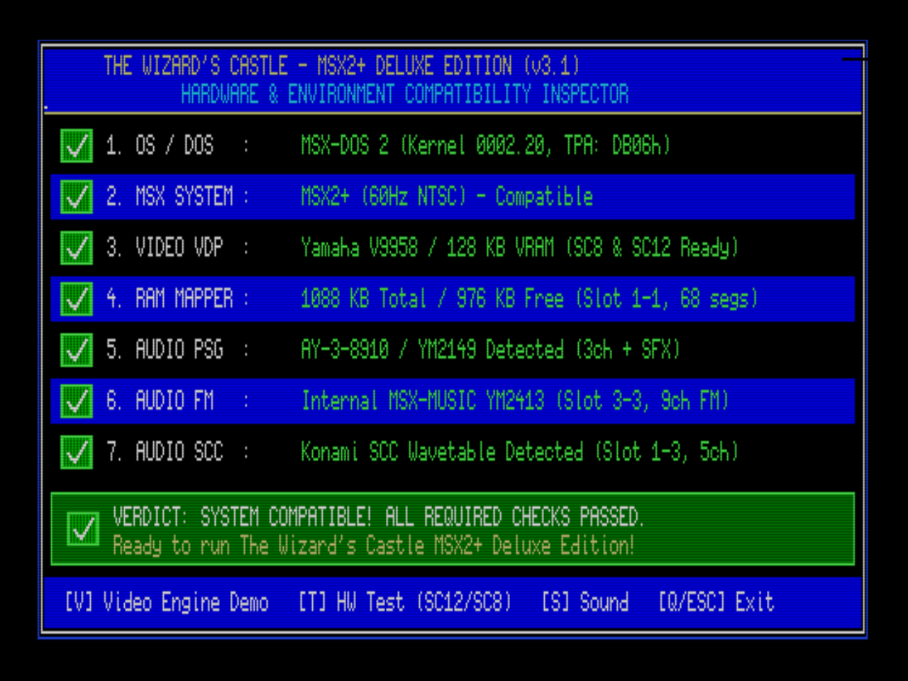
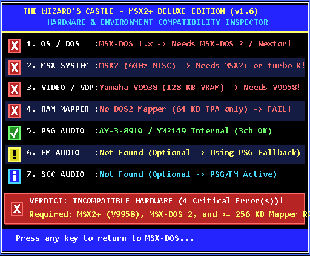
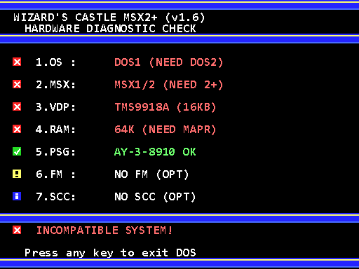
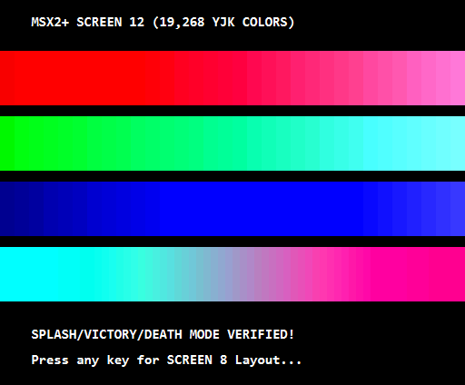
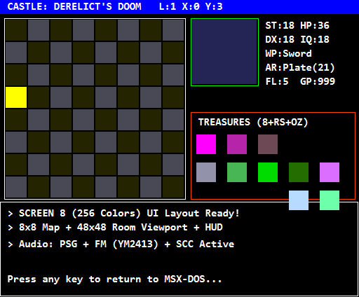
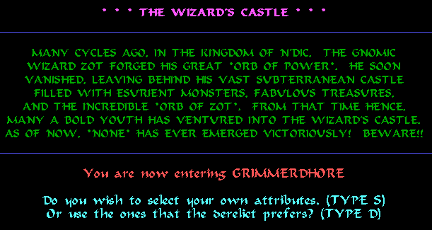
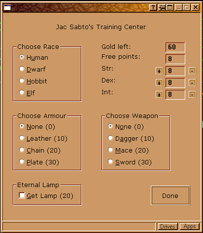
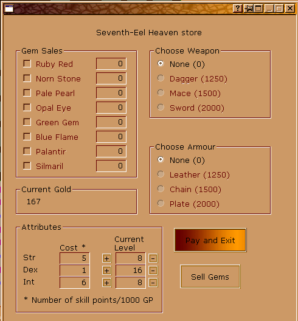

# The Wizard's Castle — MSX2+ Enhanced Edition

An enhanced MSX2+ / MSX-DOS 2 graphical and musical port of **The Wizard's Castle** (originally created by **Joseph R. Power** in 1980 for *Recreational Computing*, and ported to C++ as **WinWiz** by **Daniel D. Miller**), powered by **MSXgl**.

---

## Overview / Visão Geral

**The Wizard's Castle** is one of the earliest computer RPGs ever published. The player explores an 8×8×8 dungeon (512 rooms across 8 floors) filled with monsters, treasures, pools, chests, vendors, warps, and sinkholes in search of the **Orb of Zot** and the **Runestaff**.

This **MSX2+ Enhanced Edition** preserves **100% gameplay compatibility** while taking full advantage of the MSX2+ hardware architecture:

- **100% Hybrid Rules Engine:** Choose at startup between:
  - **WinWiz Mode:** Faithful to Daniel D. Miller's C++ port (`winwiz/`), including interactive Zot chest riddles, single-key context actions (`[E]xecute`), and WinWiz combat formulas.
  - **Classic 1980 Mode:** Faithful to Joseph R. Power's original 1980 BASIC rules (weapon damage `WC + STR/3`, armor damage reduction, and classic commands `[G]aze`, `[O]pen`, `[T]rade`, `[D]rink`).
- **Dual Video Mode Presentation (V9958):**
  - **SCREEN 12 (256×212, 19,268 YJK colors):** Full-color Splash Screen, Victory Screen, and Game Over / Death Screen.
  - **SCREEN 8 (256×212, 256 GRB colors + VRAM Page 1 hardware blitter cache):** Interactive 8×8 floor map (`16×16` tiles), `48×48` Room & Combat Viewport (`32×32` sprites), real-time Character HUD, 10 Treasure slots (`12×12` icons), and an 8-line hardware-scrolled (`YMMM`) color message log.
- **Multi-Chip Soundtrack & Sound Effects:**
  - **Music (lVGM):** Hybrid background soundtrack utilizing **PSG (AY-3-8910)** + **MSX-MUSIC (YM2413 / OPLL FM)** + **Konami SCC** (when present).
  - **Sound Effects (ayFX):** 16 distinct in-game sound effects (footsteps, stairs, sinkholes, warps, sword hits, fireballs, vendor chimes, victory/death fanfares) mixed on PSG Channel C.
- **Bilingual Support:** Full in-game localization in **English (`EN`)** and **Portuguese (`PT-BR`)**.
- **Adaptive Graphical Hardware Diagnostic Dashboard, Memory Mapper Asset Bank & Universal Boot Disk (`v2.1`):**
  - **Universal Boot Disk (`DOS2_wizcastle.dsk`):** Bundled with `MSXDOS2.SYS` + `COMMAND2.COM` (MSX-DOS 2), `MSXDOS.SYS` + `COMMAND.COM` (MSX-DOS 1.11), `AUTOEXEC.BAS` (MSX Disk-BASIC fallback), and **`WIZDATA.DAT` (`112 KB`, 7 × 16 KB Mapper segments)** so **any** MSX machine (MSX1, MSX2, MSX2+, or turbo R) boots directly into the diagnostic report instead of dropping to a blank BASIC prompt.
  - **MSX-DOS 2 Memory Mapper Bank (`src/wiz_mapper.c`):** Allocates 7 user segments (`112 KB`) via `DOSMapper_Alloc()`, loads `WIZDATA.DAT` with a graphical progress bar in `SCREEN 7`, verifies the `"WIZDATA1"` integrity signature, and streams `160×100` `SCREEN 12` YJK paintings (`[1]` Combat, `[2]` Victory, `[3]` Death) + `SCREEN 8` `16×16` dungeon tiles, treasure icons, and `32×32` room sprites (`[1]` Dragon, `[2]` Balrog, `[3]` Chest, `[4]` Elf) directly from banked RAM (`0x8000–0xBFFF`).
  - **`SCREEN 7` (`512×212`, 16 colors) on MSX2 / MSX2+ / turbo R:** High-resolution graphical inspector with `20×12` pixel badges (`[✓]` Green, `[✗]` Red, `[!]` Yellow, `[i]` Cyan).
  - **`SCREEN 2` (`256×192`, 32×24 tiles) on MSX1 (`TMS9918A`):** Custom 8×8 graphical badge tiles (`[✓]`, `[✗]`, `[!]`, `[i]`) and color-coded status rows using pure `R#0..R#7` register writes (preventing 3-bit `TMS9918A` register mirroring).

---

## Screenshots / Galeria Visual

### 1. Adaptive Graphical Hardware Diagnostic Dashboard (`v1.6`)

| **MSX2+ / turbo R — `SCREEN 7` (`512×212`, 100% Compatible)** |
| :---: |
|  |

| **MSX2 (`V9938` / `MSX-DOS 1`) — `SCREEN 7` (`512×212`)** | **MSX1 (`TMS9918A` / `MSX-DOS 1`) — `SCREEN 2` (`256×192`)** |
| :---: | :---: |
|  |  |

### 2. Interactive Visual & Audio Hardware Verification (`[T]` / `[S]` Keys)

| `SCREEN 12` Test (19,268 YJK Colors + PSG/FM/SCC Audio) | `SCREEN 8` Game UI Layout Mockup (256 GRB Colors) |
| :---: | :---: |
|  |  |

### 3. Original Reference Version Being Ported (*WinWiz* by Daniel D. Miller)

| Intro & Rules Screen | Main Dungeon Map & HUD | Vendor Trading Screen |
| :---: | :---: | :---: |
|  |  |  |

---

## Hardware Requirements / Requisitos de Sistema

| Component | Minimum Required | Recommended Target |
| :--- | :--- | :--- |
| **Computer** | MSX2+ (or MSX2 with V9958 upgrade) | **MSX2+ / MSX turbo R** |
| **VDP** | Yamaha **V9958** (`SCREEN 8` & `SCREEN 12`, 128 KB VRAM) | Yamaha **V9958** (128 KB VRAM) |
| **OS** | **MSX-DOS 2.20+** (`MSXDOS2.SYS` + `COMMAND2.COM`) | **MSX-DOS 2.30+ / Nextor** |
| **Memory Mapper** | ≥ 128 KB free in Mapper (`≥ 256 KB` total RAM) | **1024 KB (1 MB) Memory Mapper** |
| **Audio** | PSG (AY-3-8910 / YM2149) | **PSG + MSX-MUSIC (YM2413 FM) + Konami SCC** |

---

## Repository Structure / Estrutura do Projeto

```text
wizcastle/
├── docs/                           # Complete Project Documentation
│   ├── PLAN.md                     # Architecture & Implementation Plan
│   ├── SPEC.md                     # Technical Specification (Memory, VRAM, Audio, Rules)
│   ├── OUTLINE.md                  # Feature Roadmap & Implementation Progress
│   └── MANUAL.md                   # Build Guide & Complete Player's Manual
├── MSXgl/                          # MSXgl Engine & Build Tools (by Aoineko)
│   └── projects/
│       └── wizcastle/              # MSX2+ Game Source Code & Build Scripts
│           ├── build.bat           # Build script -> out/wizcastle.com & .dsk
│           ├── project_config.js   # MSXgl build configuration (MSX2+, DOS2)
│           ├── msxgl_config.h      # MSXgl engine module configuration
│           ├── wizcastle.c         # Main entry point (DOS2 main)
│           ├── tools/              # Asset conversion scripts (build_assets.ps1 -> WIZDATA.DAT)
│           ├── emul/               # Bootable disk files, WIZDATA.DAT & DOS2_wizcastle.dsk
│           └── src/                # Game modules (wiz_hwcheck, wiz_mapper, wiz_version)
├── winwiz/                         # Reference C++ Port by Daniel D. Miller (CC0 1.0)
├── CHANGELOG.md                    # Complete X.Y Version & Build History
├── resume.txt                      # Multi-PC Development Handoff & Progress Summary
├── LICENSE                         # Licensing & Third-Party Attributions
└── README.md                       # This file
```

---

## Building from Source / Como Compilar

All required build tools (SDCC 4.6.0, Node.js, ZX0 compressor, and Disk Manager) are bundled inside `MSXgl/tools/`.

```powershell
cd MSXgl\projects\wizcastle
.\build.bat
```

### Build Outputs
- **Executable:** `MSXgl/projects/wizcastle/out/wizcastle.com`
- **Bootable MSX-DOS 2 Disk Image:** `MSXgl/projects/wizcastle/emul/dsk/DOS2_wizcastle.dsk`

### Running on openMSX
```powershell
openmsx -machine Panasonic_FS-A1WX -ext scc -diska MSXgl\projects\wizcastle\emul\dsk\DOS2_wizcastle.dsk
```

---

## Documentation / Documentação

- [**Implementation Plan (`docs/PLAN.md`)**](docs/PLAN.md) — Architectural design and 5-phase engineering plan.
- [**Technical Specification (`docs/SPEC.md`)**](docs/SPEC.md) — Detailed specs for hardware validation, Z80/Mapper memory layout, VRAM layout, audio engine, and Classic vs. WinWiz formulas.
- [**Project Outline (`docs/OUTLINE.md`)**](docs/OUTLINE.md) — Checklist of implemented features and upcoming tasks.
- [**Complete Manual (`docs/MANUAL.md`)**](docs/MANUAL.md) — Compilation instructions, hardware diagnostics guide, and the complete player's manual.

---

## Credits & License / Créditos e Licença

- **Original Game (1980):** Joseph R. Power (*Recreational Computing*, July/August 1980).
- **WinWiz C++ Port:** Daniel D. Miller — released under [**CC0 1.0 Universal**](winwiz/LICENSE.txt).
- **MSXgl Library:** Guillaume "Aoineko" Blanchard — released under [**CC BY-SA 4.0**](MSXgl/LICENSE.md).
- **32×32 Dungeon Tileset:** NetHack DevTeam — released under the **NetHack General Public License**.

This repository is distributed under **CC BY-SA 4.0**, with the standalone MSX2+ C port code in `MSXgl/projects/wizcastle/` and documentation in `docs/` dual-licensed under **MIT** and **CC BY-SA 4.0**. See [`LICENSE`](LICENSE) for full details.
