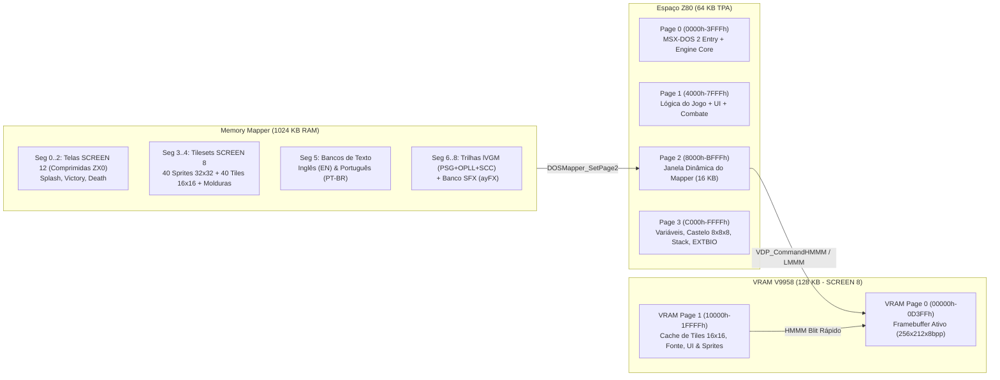

# Plano de Implementação: The Wizard's Castle — MSX2+ Deluxe Edition

## Objetivo
Criar um port completo e aprimorado de **The Wizard's Castle** (baseado no código C++ de [winwiz](../winwiz/winwiz.cpp) e nas regras clássicas de 1980 de Joseph R. Power) para a arquitetura **MSX2+ com 1024 KB de Memory Mapper sob MSX-DOS 2**, utilizando a biblioteca **MSXgl** ([MSXgl](../MSXgl/README.md)).

O projeto combina:
1. **Compatibilidade 100% (Modo Híbrido Configurável):** Escolha na abertura entre o modo **WinWiz** (regras e balanceamento de Daniel Miller em [combat.cpp](../winwiz/combat.cpp) e [wfuncs.cpp](../winwiz/wfuncs.cpp)) e o modo **Classic 1980** (geometria *wrap-around* 8×8×8, saída pela entrada do castelo em `(0,3,0)` com o *Orb of Zot*, *Warp* ocultando o Orbe e fórmulas clássicas de combate/atributos), aceitando tanto a tecla unificada `[E]xecute` quanto os comandos clássicos individuais (`[G]aze`, `[O]pen`, `[T]rade`, `[D]rink`/`[R]`).
2. **Gráficos MSX2+ (V9958 com 128 KB de VRAM):**
   - **SCREEN 12 (256×212, YJK 19.268 cores):** Tela de abertura (*Splash Screen*), tela de Vitória e tela de Derrota (*Game Over*), aproveitando as artes de [images.png](../winwiz/images.png) e arte dedicada do Castelo de Zot.
   - **SCREEN 8 (256×212, 256 cores GRB 3-3-2):** Tela principal do jogo, criação de personagem e loja do *Vendor*, exibindo simultaneamente o **Mapa 8×8 do andar** (tiles 16×16), **Viewport Ilustrada da Sala/Encontro** (tiles 32×32 extraídos de [tiles32.png](../winwiz/tiles32.png) com moldura de masmorra mostrando a sala, objetos, personagens e monstros), **HUD de Status e Tesouros** e **Terminal Colorido de Mensagens**.
3. **Suporte Bilíngue (EN / PT-BR):** Seleção de idioma na abertura (Inglês original ou Português), mantendo o suporte ao enigma do baú de Zot (*Zot's smoky room chest*) compatível com o nome do castelo atual.
4. **Áudio PSG + FM (MSX-MUSIC / OPLL) + SCC + Efeitos Sonoros (SFX):**
   - Música de fundo polifônica combinando **FM (YM2413 / OPLL)**, **Konami SCC** (quando detectado) e **PSG (AY-3-8910)** via reprodutor **lVGM** ([lvgm_player.h](../MSXgl/engine/src/vgm/lvgm_player.h)) na interrupção de `VBlank` (temas para Abertura, Exploração, Combate, Vitória e Game Over).
   - Efeitos sonoros instantâneos via **ayFX** ([ayfx_player.h](../MSXgl/engine/src/ayfx/ayfx_player.h)) no Canal C do PSG (passos, escadas, espada, acerto/erro, dano sofrido, magias *Web/Fireball/Deathspell*, ouro, baú, *warp*, *sinkhole*, piscina mágica, *Runestaff* e *Orb of Zot*).

---

## Arquitetura de Memória no MSX-DOS 2 (1024 KB Mapper + 128 KB VRAM)

O programa é compilado como target `DOS2` (`WIZCASTL.COM`) no diretório `MSXgl/projects/wizcastle/`. Ao iniciar no MSX-DOS, ele primeiro executa a **rotina de autodiagnóstico de hardware** (verificando MSX-DOS 1 vs 2, geração MSX1/2/2+/turbo R, VDP e VRAM, Memory Mapper e RAM livre, PSG, FM/OPLL e SCC). Em seguida, aloca segmentos de 16 KB do Memory Mapper via Extended BIOS ([dos_mapper.h](../MSXgl/engine/src/dos_mapper.h)) e carrega o pacote de recursos (`WIZDATA.DAT`) do disco para a RAM mapeada.



---

## Layout da Tela Principal em SCREEN 8 (256×212, 256 cores)

```
+-------------------------------------------------------------------+ (0,0)
| CASTLE: DERELICT'S DOOM              LVL:1  X:0 Y:3  [WINWIZ/1980]| (Barra Topo: 256x10)
+-----------------------------------+-------------------------------+ (0,10)
|                                   | +-----------+  ST: 18  HP: 36 |
|                                   | |  VIEWPORT |  DX: 18  IQ: 18 |
|         MAPA DO ANDAR 8x8         | |  DA SALA  |  WP: Sword      |
|       (8x8 tiles de 16x16 px      | |  (48x48)  |  AR: Plate (21) |
|         = 128x128 pixels)         | |  Monstro/ |  FL: 5   LM: ON |
|                                   | |  Objeto/  |  GP: 1250       |
|   * Cursor animado (Sprite M2)    | |  Jogador  |-----------------+
|   * Salas conhecidas / escuras    | +-----------+  TESOUROS (10): |
|   * Ícones coloridos de objetos   | [Sala/Inimigo] [8 Gems+RS+OZ] |
|                                   | [HP Inimigo ]  (Ícones 12x12) |
+-----------------------------------+-------------------------------+ (0,146)
| > Here you find a Kobold.                                         |
| > Round 1: You're facing a kobold [ L1, hp=3 ]                    |
| > You may: [A]ttack, [R]etreat, [C]ast a spell.                   | (Terminal Rolável:
| > You hit the kobold for 6 points, killing it. [ A45, D8 ]        |  8 linhas de texto
| > GREAT ZOT!! You've found the RUNESTAFF!!                        |  42 colunas, fonte
| > Command? [Arrows:Move L:Look F:Flare E:Exec P:Tele J:Items H:?] |  6x8 colorida)
+-------------------------------------------------------------------+ (255,211)
```

---

## Diferenças de Regras no Modo Híbrido (`Classic 1980` vs `WinWiz`)

| Aspecto | Modo **WinWiz** (Fiel ao C++) | Modo **Classic 1980** (Fiel ao BASIC) |
| :--- | :--- | :--- |
| **Bordas do Mapa** | Paredes sólidas em `X=0..7` e `Y=0..7` ([wfuncs.cpp](../winwiz/wfuncs.cpp)). | Geometria *wrap-around* (`0 <-> 7`); sair ao Norte da entrada `(0,3,0)` pergunta se deseja sair do castelo. |
| **Condição de Vitória** | Beber de uma `POOL` possuindo o *Orb of Zot* abre um portal para a floresta. | Sair pela entrada do castelo `(0,3,0)` carregando o *Orb of Zot* (além de também permitir o portal da piscina). |
| **Localização do Orb of Zot** | Quarto vazio aleatório acessível via teletransporte (`[P]`) com a *Runestaff*. | Disfarçado como um `WARP`: entrar nele sem *Runestaff* teletransporta; entrar nele (ou teletransportar para ele) com *Runestaff* revela o *Orb of Zot*. |
| **Combate e HP** | `HP máximo = 2 * ST`; ataque e defesa percentuais de [combat.cpp](../winwiz/combat.cpp). | `ST` funciona diretamente como pontos de vida; `Acerto = DX >= 1..20 + 3*Blind`; `Dano = Weapon - Armor`. |
| **Curse of Lethargy** | Flag ativa (curada pelo *Ruby Red*). | Monstros têm o primeiro turno de ataque ao entrar na sala e o tempo avança em dobro. |
| **Atalhos de Teclado** | `[E]xecute` contextual + suporte aos atalhos clássicos (`[O]pen`, `[G]aze`, `[T]rade`, `[D]rink`/`[R]`, `[Q]uit`). | Teclas clássicas individuais + suporte também à tecla `[E]xecute` por conveniência. |

---

## Estrutura de Módulos

1. **`tools/build_assets.js`**: Extrai e converte os 40 sprites (`32×32`, `16×16`, `12×12`) de [tiles32.png](../winwiz/tiles32.png) para SCREEN 8, converte as 3 artes de [images.png](../winwiz/images.png) para SCREEN 12 comprimidas com ZX0, compila as trilhas `.LVM` (PSG+OPLL+SCC) e `.AFX` (ayFX) e gera `WIZDATA.DAT`.
2. **`wizcastle.c` & `src/wiz_hwcheck.c`**: Entrada principal e diagnóstico completo de hardware (MSX1/2/2+/TR, VDP/VRAM, MSX-DOS 1/2, Memory Mapper, PSG, FM/OPLL, SCC).
3. **`src/wiz_mapper.c`**: Gerenciamento de segmentos de 16 KB do MSX-DOS 2 e carregamento de `WIZDATA.DAT`.
4. **`src/wiz_video.c`**: Motor gráfico SCREEN 12 e SCREEN 8 acelerado por hardware V9958 (`HMMM`, `YMMM`, `LMMM`, Sprites Modo 2).
5. **`src/wiz_audio.c`**: Reprodutor de música PSG+FM+SCC via lVGM + 16 efeitos sonoros via ayFX no VBlank.
6. **`src/wiz_castle.c`, `src/wiz_gameplay.c`, `src/wiz_combat.c`**: Lógica completa de geração do castelo 8×8×8, exploração, objetos, maldições e combate nos modos `WinWiz` e `Classic 1980`.
7. **`src/wiz_dialogs.c` & `src/wiz_locale.c`**: Telas de criação de personagem, loja do mercador, enigma de Zot, ajuda e localização bilíngue (`EN` / `PT-BR`).
